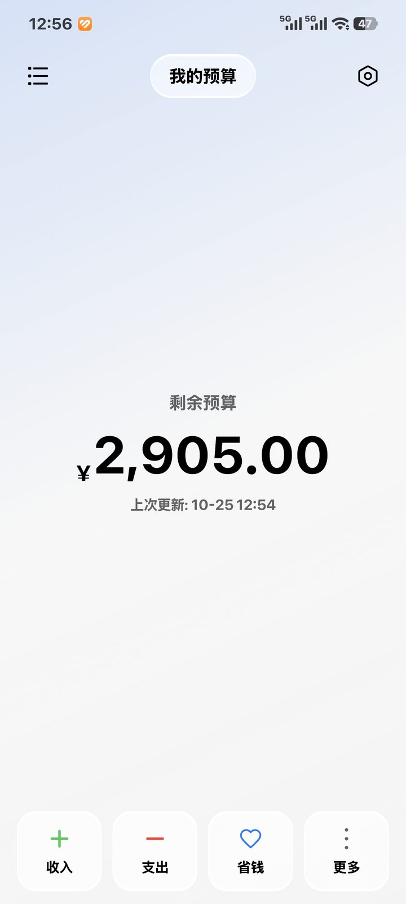
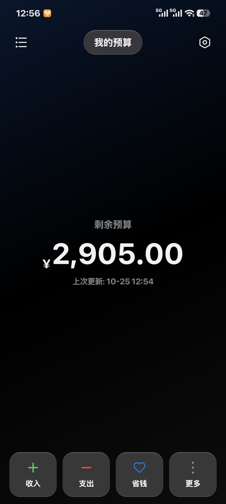
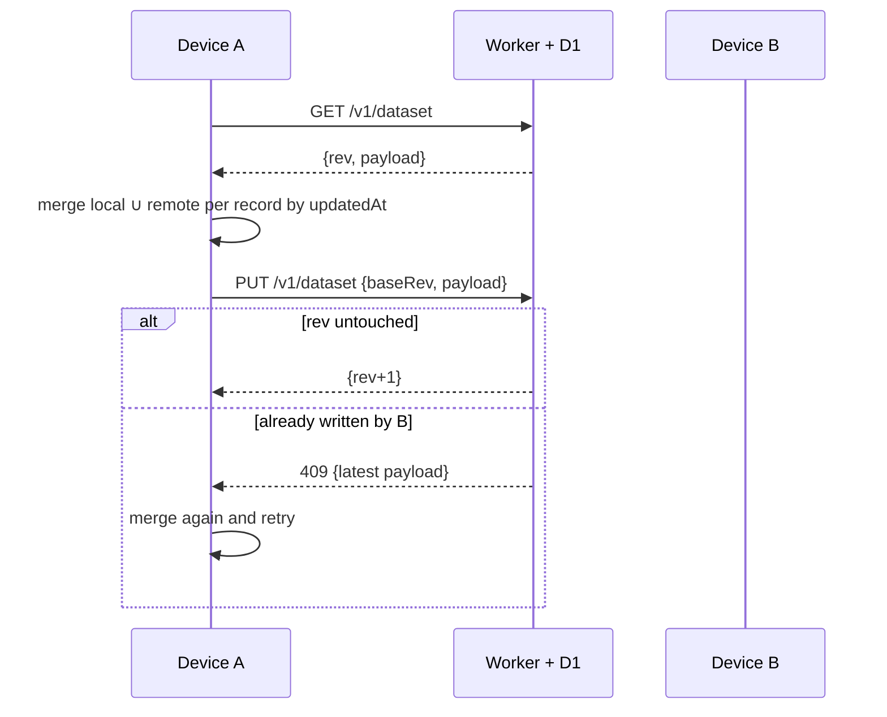

# Budget Meow · budget-meow


English · [**简体中文**](README.md)

A budget app for students managing their monthly living allowance. Set the month's allowance first,
then every expense is subtracted from it. Entry is a calculator that evaluates expressions — not a plain input field.

Native Android, UI rebuilt with [Miuix](https://github.com/compose-miuix-ui/miuix) (HyperOS style).
Works fully offline; optional account + multi-device sync; self-hostable backend in `server/`.

[](https://github.com/303world/budget-meow/actions/workflows/build.yml)
[](LICENSE)
[](#build)

<p>


</p>

## Download & links

| | URL | Notes |
|---|---|---|
| **Android app** | [Releases](https://github.com/303world/budget-meow/releases/latest) | **Use this one** — actively maintained |
| Web app | <https://app-1778154199542-u11q8myzx-default.tacore.ai/> | **No longer maintained** (archive only) |

The two versions **do not share data**. To migrate: export JSON from the web app, then import it in
the Android app under *Settings → Backup → Restore*.

> `keystore/budget-meow-ci.p12` (password `budgetmeow`) is a **public CI debug key** so that every build
> is signed identically and can be installed over the previous one. Do not use it for official releases.

## Features

**Bookkeeping**

- **Monthly budget setup** — required on first launch of each month, carries over last month's
  carry-over and advance; **previous months are kept** and browsable with a month switcher
- **Calculator entry** — arithmetic with parentheses, tap/drag to move the caret, blocks negative
  results and division by zero
- **Five record types** — income / expense / saving / carry-over / advance
- **Nine confirmation rules** — large amounts, over-budget spending, trip budget too large, …
- **Trip sub-ledger** — its own balance and entries, settles back into the main ledger; empty trips roll back cleanly
- **History** — month switching, multi-select, batch revert (reverse entry) and delete (list only),
  note editing; non-revertable records are dimmed with an explanation
- **Compound search** — keyword + amount range + date range, with this month / 7 days / 30 days presets
- **Stats** — income, expense, net expense, savings, trip count and trip spending for the month;
  12-month bar chart for the year

**Appearance**

- Light / dark / scheduled dark, bold text, fullscreen mode, custom header title
- **Liquid glass** — header, quick actions, calculator sheet and toast use real backdrop blur with a lit edge
- Wallpaper import that **does not tint the image** — foreground text flips between black and white
  based on the wallpaper's average luminance, backed by a soft shadow
- App icon is a cat-and-pig illustration; regenerate it with `tools/make_icon.py`

**Sync (optional)**

- Email + password sign-up; automatic sync across devices, plus a manual "sync now"
- Record-level last-write-wins on `updatedAt`; deletions are tombstones, so nothing comes back from the dead
- No network calls unless you sign in (update checks can be disabled)
- Local ledgers (profiles) and cloud accounts are independent: sync applies to **the current ledger only**

**Updates**

- Automatic check on launch (can be disabled) with an "update now?" prompt
- **In-app update**: downloads the APK and hands it to the system installer — no browser hop

## Architecture

```
app/src/main/kotlin/io/github/world303/budgetmeow/
├── core/
│   ├── model/     domain models, stats rules, merge algorithm, money formatting
│   ├── calc/      expression parser, calculator state machine, confirm rules
│   ├── storage/   on-disk DTOs, atomic writes (tmp → fsync → rename), dataset codec
│   ├── repo/      BudgetRepository (local impl; cloud sync plugs in here)
│   ├── backup/    import/export of web-app backups v1/v2/v3
│   ├── sync/      MeowApi, AuthStore, SyncController
│   ├── update/    update check, download, PackageInstaller integration
│   └── store/     BudgetStore (bookkeeping), SettingsStore (profiles & settings)
├── feature/       home, calculator, history, search, stats, settings, account, consent, about
└── ui/            theme & glass materials, shared components, navigation
```

`core/` is Compose-free and unit-testable on the JVM. State is `StateFlow` + hand-written stores —
no ViewModel/Hilt, which this size does not need.

| Layer | Choice |
|---|---|
| Language / UI | Kotlin 2.4.20 + Jetpack Compose 1.12.1 |
| Design system | Miuix 0.9.4 (Apache-2.0) |
| Persistence | single-file JSON (kotlinx.serialization) + atomic writes |
| Sync backend | Cloudflare Workers + D1 (free tier is plenty for dozens of users) |
| Build | AGP 9.4.1 / Gradle 9.7.1 / JDK 21, `minSdk 33`, `compileSdk 37` |

### Build

Requires JDK 21 and Android SDK 37.

```bash
./gradlew :app:testDebugUnitTest    # calculator, stats rules, backup compatibility, merge, bookkeeping flow
./gradlew :app:assembleDebug
./gradlew :app:assembleRelease      # R8 enabled, ~3 MB output
```

`minSdk 33` comes from liquid glass: `miuix-blur` needs AGSL RuntimeShader. To support Android 8–12,
swap the blur implementation for [kyant backdrop](https://github.com/Kyant0/AndroidLiquidGlass)
(Apache-2.0, supports API 26) — two call sites in `ui/theme/MeowGlass.kt`.

CI runs tests on every push to `main` and publishes debug/release APKs; pushing a `v*` tag creates a Release.

## How sync works



1. **Deletes are tombstones** (`deleted=true` + `updatedAt`) so they propagate instead of resurrecting.
2. **Merge is per record**, not whole-dataset replacement: both devices' new entries survive.
3. **Server rev is the arbiter**; the client re-merges up to 4 times instead of silently losing data.
4. **Monthly summaries merge by month** (two devices may each have created one), trips by id.

### API

| Method | Path | Description |
|---|---|---|
| POST | `/v1/register` | email + password → token |
| POST | `/v1/login` | login |
| POST | `/v1/logout` | revoke current token |
| GET | `/v1/dataset` | fetch snapshot |
| PUT | `/v1/dataset` | push snapshot (`baseRev` optimistic lock; 409 = re-merge) |
| POST | `/v1/password` | change password, revoke other devices |
| DELETE | `/v1/account` | delete account and cloud data |

Passwords use PBKDF2-SHA256 with a random salt and 100k iterations (Workers' WebCrypto cap);
only token hashes are stored, expiring after 180 days.

## Self-hosting the backend

`server/` is the complete backend — about five minutes to deploy:

```bash
cd server
wrangler d1 create budget-meow          # put the returned database_id into wrangler.toml
wrangler d1 execute budget-meow --file schema.sql --remote
wrangler deploy
```

Then change `DEFAULT_API_BASE` in `core/sync/MeowApi.kt` and rebuild.

The official instance runs on the author's free-tier account — **no uptime guarantee**. Keep backups or self-host.

## Data & migration

- Data lives in the app's private `files/meow/`; uninstalling removes it. Export backups yourself.
- Backup format matches the web app (5 tables + `_exportMeta.version`), so **web-app JSON imports directly**
  and exported files can be re-imported there.

## Accounting rules (and fixes over the web version)

The web version counted budget transfers as income/expense: starting a trip with 300 recorded an expense,
spending 120 during the trip recorded another, so the month showed 420 spent instead of 120; settling the
trip recorded the leftover as income. Advances and carry-overs had the same issue.

This version counts only real cash flow:

| Counted as | Record types |
|---|---|
| Income | `income`, `trip_income` |
| Expense | `expense`, `trip_expense` |
| Savings | `save` |
| Trip count | number of `trip_end` records (with manual calibration) |

`init / adjust / debug / advance / advance_deduct / carryover / carryover_income / trip_start / trip_add / trip_end`
are budget transfers and are excluded.

Other fixes: date filters use the **local** date (the web version used UTC, shifting entries made before
8am in UTC+8 to the previous day); clearing the month is blocked during a trip; empty-trip detection
scans **all** entries; yearly stats include all 12 months for past years.

## Roadmap

- [x] v1.0 complete offline bookkeeping
- [x] v1.1 accounts and cross-device sync
- [x] v1.2 rewritten copy/UX, month switching, top glass toast
- [x] v1.3 first-launch consent, in-app updates
- [ ] CSV export, richer stats
- [ ] iOS via Compose Multiplatform

## License

GPL-3.0. Derivative works must be released under the same license, with no warranty.

For closed-source commercial use, contact the author for a commercial license of **newer versions**
(dual licensing). Versions already published under GPL-3.0 stay under GPL-3.0.

## Credits

- [NexioSchedule](https://github.com/HaoZai000/NexioSchedule) — timetable app; reference for layout and liquid glass
- [Miuix](https://github.com/compose-miuix-ui/miuix) — HyperOS-style Compose component library, the UI skeleton
- [kyant backdrop](https://github.com/Kyant0/AndroidLiquidGlass) — pioneering liquid glass implementation
- Kotlin, Compose, kotlinx.coroutines, kotlinx.serialization (all Apache-2.0)
