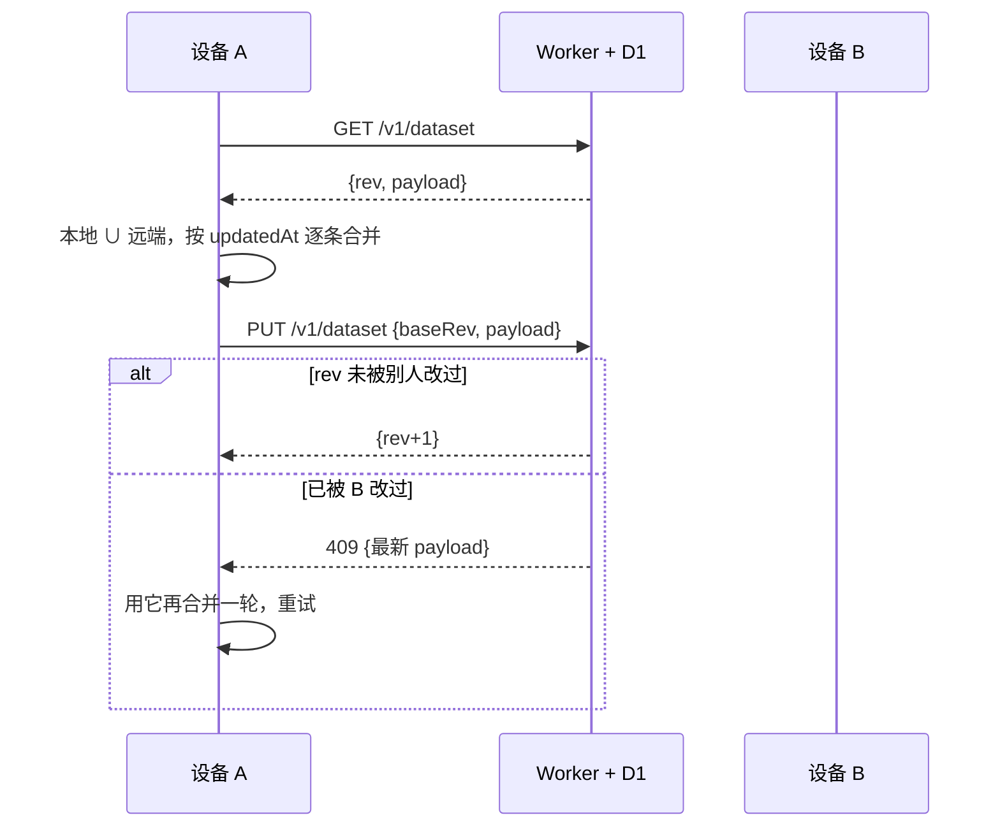

# 预算喵 · budget-meow


给大学生管生活费的预算记账 App。先把每月生活费定下来，每花一笔就从里面扣；
记账入口是一台能算式的计算器，而不是一个输入框。Android 原生，界面用
[Miuix](https://github.com/compose-miuix-ui/miuix)（HyperOS 风格）重写。

- **Android 版（优先维护）**：[Releases](https://github.com/303world/budget-meow/releases/latest)
- **网页版（已停止维护）**：<https://app-1778154199542-u11q8myzx-default.tacore.ai/>
- 两版数据**不互通**；网页版导出的 JSON 可以在 App 的「设置 → 备份 → 恢复数据」里导入。
- 可以纯离线用，也可以登录同步；有服务器能力的可以照 `server/` 自建后台。

记一笔账不是填一个输入框，而是按一台计算器：`1200/3+58` 直接算出该记多少；长按表达式出现放大镜，配光标把数字改到某一位。数据默认只在本机，登录后可在多台设备间按记录合并同步。

[](https://github.com/303world/budget-meow/actions/workflows/build.yml)
[](LICENSE)
[](#构建)

> 起点是作者早年写的一版网页应用（React + MobX + Dexie）。这一版把功能逐项搬到 Android，
> 并修掉了原版几处记账口径问题——详见[记账口径](#记账口径)。
>
> 界面与液态玻璃的实现参考了 [NexioSchedule](https://github.com/HaoZai000/NexioSchedule)（课程表 App），特此致谢。

---

## 功能

**记账**

- **预算初始化**：每月首次进入必须设定本月预算，自动带入上月的结转与预支
- **计算器面板**：四则运算与括号、点选光标、长按放大镜（左右滑动逐字移动）、负数与除零拦截
- **五种流水**：收入 / 支出 / 省钱 / 结转下月 / 预支下月
- **九类二次确认**：大额、超预算、结转用完、预支超预算、出行预算过大……该拦的都不放过
- **出行子账本**：独立余额与明细，结束后结转回主账本；没真正出行过的空行程会完整回滚
- **历史记录**：无限滚动、长按多选、批量撤回（反向记账）与删除（仅删流水）、改备注
- **复合搜索**：关键词 + 金额区间 + 日期区间，另有本月 / 近 7 天 / 近 30 天快捷区间
- **统计**：本月收入、支出、净支出、省钱、出行次数与出行支出；年度 12 个月收支柱状图
- **本地多配置档**：多份互相隔离的账本，等价于原网页版的多账号

**外观**

- 浅色 / 深色 / 定时深色
- **液态玻璃**：顶栏药丸、四个快捷按钮、计算器面板、顶部提示条都是实时背景模糊 + 受光描边（固定开启）
- 支持导入壁纸（玻璃才有东西可模糊）、粗体字、全屏模式、自定义顶栏标题
- 应用图标是猫 + 猪的插画，`tools/make_icon.py` 可从原图一键重新生成

**同步（可选）**

- 邮箱 + 密码注册登录，登录后自动跨设备同步
- 合并按记录粒度的 `updatedAt` 做 last-write-wins，删除用墓碑标记，不会"删了又活"
- 不登录时**零网络请求**；账目只在你自己的同步服务上

## 下载

到 [Releases](https://github.com/303world/budget-meow/releases) 下 `app-release.apk`（约 1.6 MB）。

> 仓库里的 `keystore/budget-meow-ci.p12` 是**公开的 CI 调试密钥**（口令 `budgetmeow`），
> 只为让每次构建签名一致、能覆盖安装。正式发布请换成你自己的密钥。

## 构建

需要 JDK 21 与 Android SDK 37。

```bash
./gradlew :app:testDebugUnitTest    # 单测：计算器状态机、统计口径、备份兼容、合并算法、记账主流程
./gradlew :app:assembleDebug        # 调试包
./gradlew :app:assembleRelease      # 发布包（R8 开启，产物约 1.6 MB）
```

`minSdk 33` 是被液态玻璃抬上去的：`miuix-blur` 依赖 AGSL RuntimeShader。想兼容 Android 8–12，
把模糊换成 [kyant backdrop](https://github.com/Kyant0/AndroidLiquidGlass)（Apache-2.0，支持到 26），
改 `ui/theme/MeowGlass.kt` 里的两处调用即可。

CI 在每次 push 到 `main` 时跑单测并产出 debug/release APK；打 `v*` 标签自动发 Release。

## 架构

```
app/src/main/kotlin/io/github/world303/budgetmeow/
├── core/
│   ├── model/     领域模型、统计口径、合并算法、金额格式化
│   ├── calc/      表达式解析器、计算器状态机、二次确认规则
│   ├── storage/   磁盘 DTO、原子写（tmp → fsync → rename）、数据集编解码
│   ├── repo/      BudgetRepository（本地实现，云同步接在这里）
│   ├── backup/    网页版备份 v1/v2/v3 的导入导出
│   ├── sync/      MeowApi、AuthStore、SyncController
│   └── store/     BudgetStore（记账业务）、SettingsStore（配置档与设置）
├── feature/       首页、计算器、历史、搜索、统计、设置、账号、关于
└── ui/            主题与玻璃材质、通用组件、导航与转场
```

`core/` 全部与 Compose 解耦，能在 JVM 上直接跑单测；状态用 `StateFlow` + 手写 Store，
没有引 ViewModel/Hilt——这套体量用不上，也少一层构建负担。

| 层 | 选型 |
|---|---|
| 语言 / UI | Kotlin 2.4.20 + Jetpack Compose 1.12.1 |
| 设计语言 | Miuix 0.9.4（Apache-2.0） |
| 持久化 | 单文件 JSON（kotlinx.serialization）+ 原子写 |
| 同步服务 | Cloudflare Workers + D1（免费额度足够几十人） |
| 构建 | AGP 9.4.1 / Gradle 9.7.1 / JDK 21 |

## 同步是怎么设计的



几条硬规则：

1. **删除是墓碑**。`deleted=true` + `updatedAt`，同步后才不会在另一台设备上复活。
2. **合并是逐条的**，不是整份覆盖。两台设备各记一笔，两笔都会留下。
3. **冲突由服务端 rev 兜底**，客户端最多重合并 4 轮，不会静默丢数据。
4. **汇总按月取新**（同月可能两台设备各自建过 summary），出行与明细按 id 合并。

### 接口

| 方法 | 路径 | 说明 |
|---|---|---|
| POST | `/v1/register` | 邮箱 + 密码注册，返回令牌 |
| POST | `/v1/login` | 登录 |
| POST | `/v1/logout` | 注销当前令牌 |
| GET | `/v1/dataset` | 取账目快照 |
| PUT | `/v1/dataset` | 提交快照（`baseRev` 乐观锁，409 表示需重合并） |
| POST | `/v1/password` | 改密码，踢掉其它设备令牌 |
| DELETE | `/v1/account` | 注销账号并删除云端账目 |

密码用 PBKDF2-SHA256 加盐 10 万次（Workers 的 WebCrypto 上限）；令牌只存哈希，180 天过期。

## 自托管同步服务

仓库里的 `server/` 就是完整后端，可以自己部一套（约 5 分钟）：

```bash
cd server
wrangler d1 create budget-meow          # 把返回的 database_id 填进 wrangler.toml
wrangler d1 execute budget-meow --file schema.sql --remote
wrangler deploy
```

然后把 `core/sync/MeowApi.kt` 里的 `DEFAULT_API_BASE` 换成你的 Worker 地址，重新构建。

官方实例是作者自己的免费账号，**不承诺可用性**，重要数据请自己备份或自建。

## 数据与迁移

- 数据在 App 私有目录 `files/meow/`，卸载即删除；请自行导出备份。
- 备份格式与网页版一致（5 张表 + `_exportMeta.version`），**网页版导出的 JSON 可以直接导入**，
  导出的文件也能导回网页版。
- 备份里不含昵称与头像。

## 记账口径

原网页版有个问题：把「预算搬运」也算成了收支。开启出行 300 记一笔支出、行程里花 120 又记一笔，
这个月就显示花了 420；结束出行余额退回又记成收入；预支、结转同理。

这一版只统计真实收支：

| 计入 | 类型 |
|---|---|
| 收入 | `income`、`trip_income` |
| 支出 | `expense`、`trip_expense` |
| 省钱 | `save` |
| 出行次数 | `trip_end` 条数（含手动校准） |

`init / adjust / debug / advance / advance_deduct / carryover / carryover_income / trip_start / trip_add / trip_end`
都视为预算搬运，不进收支。

顺手修的其它问题：

- 搜索按**本地日期**筛选（原版用 ISO 前 10 位，那是 UTC，北京时间 8 点前记的账会算到前一天）
- 出行进行中禁止「清空本月记录」（否则主账本与出行子账本对不上）
- 空行程判定看**全部**明细，不再只看前 10 条
- 年度统计对往年按 12 个月算（原版一律算到当前月份）

## 路线图

- [x] v1.0 完整离线记账
- [x] v1.1 在线账号与跨设备同步
- [x] v1.2 界面与文案按「大学生生活费预算」定位重写；历史支持翻月；顶部提示条
- [ ] 改密码 / 多设备管理界面化
- [ ] CSV 导出、更多统计维度
- [ ] 检查更新支持在应用内下载安装
- [ ] iOS（Compose Multiplatform 化）

## 许可

GPL-3.0。分发衍生作品时必须以同一协议开源，且不提供担保。

如需闭源商用授权，可联系作者获取**新版本**的商业许可（双许可）；已按 GPL-3.0 发布的版本不受影响。

## 致谢

- [NexioSchedule](https://github.com/HaoZai000/NexioSchedule) —— 课程表 App，本项目的界面结构与液态玻璃参考
- [Miuix](https://github.com/compose-miuix-ui/miuix) —— HyperOS 风格 Compose 组件库，本项目的界面骨架
- [kyant backdrop](https://github.com/Kyant0/AndroidLiquidGlass) —— 液态玻璃的先行实现，Miuix 的模糊模块与之同源
- 以及 Kotlin、Compose、kotlinx.coroutines、kotlinx.serialization（均为 Apache-2.0）
